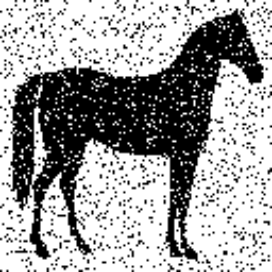
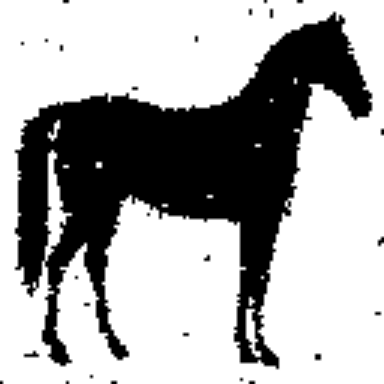

# Restauración bayesiana de imágenes

Caso de estudio de Estadística Bayesiana (Universidad Nacional de Colombia).
Se recupera una imagen limpia a partir de una versión contaminada con ruido, usando modelos que aprovechan la semejanza entre píxeles vecinos y algoritmos MCMC implementados en R.


## Modelos

| Imagen | Ruido | Modelo | Algoritmo |
|:--|:--|:--|:--|
| Binaria (caballo) | Cambio de estado con prob. ρ | Ising | Gibbs + *exchange algorithm* |
| Escala de grises (cámara) | Gaussiano | GMRF | Gibbs + Metropolis-Hastings |
| RGB (astronauta) | Gaussiano | GMRF multivariado | Gibbs + Metropolis-Hastings |

## Resultados

### Imagen binaria (ρ₀ = 0.10)

<table>
  <tr>
    <th align="center">Original</th>
    <th align="center">Contaminada</th>
    <th align="center">Restaurada</th>
  </tr>
  <tr>
    <td></td>
    <td></td>
    <td></td>
  </tr>
</table>

La proporción de píxeles correctos pasa de 90.1 % a 99 %.

## Estructura

```
BayesProject/
├── R01_grafo.R          # grafo de vecindad, Laplaciana, vectorización
├── 02_ising.R           # MCMC del modelo de Ising
├── scripts/             # experimentos
├── figuras/             # imágenes usadas en este README
└── imagenes/            # imágenes de referencia
```

## Cómo reproducir

```r
source("R01_grafo.R")
source("02_ising.R")
```

Todos los resultados usan semillas fijas (`set.seed`).

## Autores
Melissa Chaves y Owen Ortiz, estudiantes de Estadística, Universidad Nacional de Colombia.
